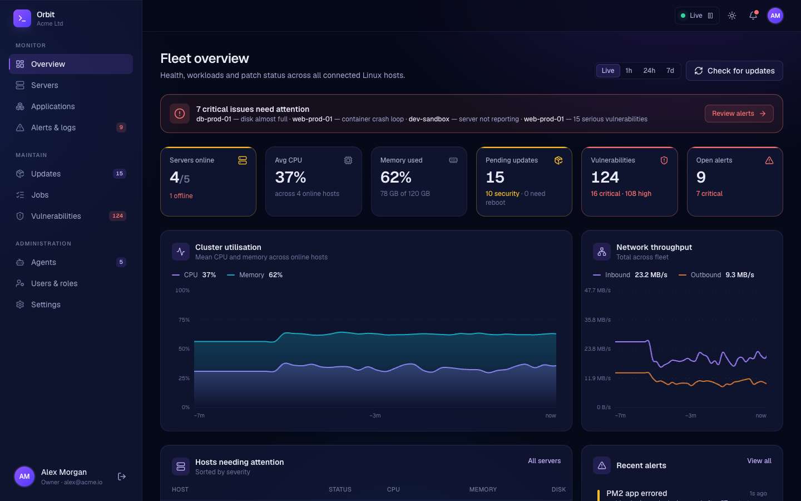

<div align="center">


# Orbit

**Monitor, patch and secure your Linux fleet from one dashboard.**

[**🌐 orbit.bltlabs.co.uk**](https://orbit.bltlabs.co.uk)

</div>

Orbit is a self-hosted, open-source tool for keeping Linux servers up to date and healthy. You run the dashboard on one machine and install a small agent on each server. From the dashboard you can see every server's health and install package updates across the whole fleet. Orbit also flags packages with known vulnerabilities before they become a problem.



## What it does

- **📈 Live monitoring:** CPU, memory, disk and network for every server, plus Docker containers, PM2 apps and systemd services.
- **📦 Updates with live logs:** install all, security-only or selected packages across many servers at once, and watch the output as it happens. You can also set maintenance windows so servers update themselves.
- **🛡️ Vulnerability alerts:** pending packages are checked against [OSV.dev](https://osv.dev), and you see which servers are affected and which version fixes each issue.
- **🚨 Alerts:** high CPU, full disks, offline servers, crashing containers and pending reboots, optionally sent to Slack.
- **🔒 Secure by design:** agents only make outbound HTTPS connections, so your servers need no open ports. The dashboard can only do what each server's own config allows, and there's no remote shell.
- **👥 Teams:** user accounts, custom roles and an audit log of every action.

It supports Ubuntu, Debian, Rocky Linux, AlmaLinux, RHEL, Fedora, Alpine and Arch, on amd64, arm64, arm and 386.

## Repositories

| Repository | What it is |
| --- | --- |
| [**orbit-dashboard**](https://github.com/Orbit-Auto-Updater/orbit-dashboard) | The web dashboard (Next.js, PostgreSQL or SQLite, Docker) |
| [**orbit-agent**](https://github.com/Orbit-Auto-Updater/orbit-agent) | The agent that runs on each server: a single static Go binary of about 7 MB |

## Get started

The full install guide is on the [website](https://orbit.bltlabs.co.uk/#install). In short:

1. Start the dashboard with Docker, using the [orbit-dashboard](https://github.com/Orbit-Auto-Updater/orbit-dashboard) repo.
2. Open it in your browser and follow the setup wizard.
3. Add each server with one command:
   ```bash
   curl -fsSL https://your-dashboard/install.sh | sudo sh -s -- --token <TOKEN>
   ```
